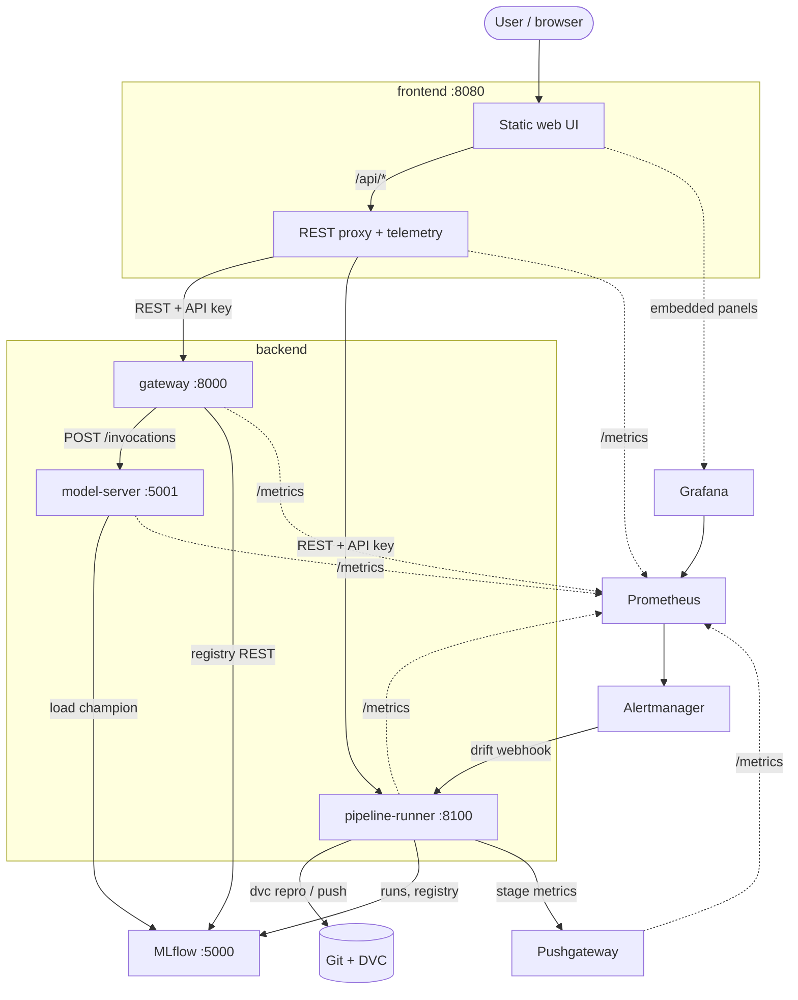

# Architecture

PlotGenre is ten Docker containers, orchestrated with Docker Compose on a single Linux host. No cloud services are used.

The diagram source is `docs/diagrams/architecture.mmd` (Mermaid). GitHub renders the same diagram below.

## Blocks

| Block | Technology | Responsibility | Port |
|---|---|---|---|
| **frontend** | FastAPI + vanilla HTML/CSS/JS | Serves the single-page UI (Classify, Pipeline console, Help). It also runs an allow-listed REST proxy that adds the API key on the server side, so the browser never sees it. Browser telemetry (page loads, UI errors, actions) is recorded as Prometheus metrics. | 8080 |
| **gateway** | FastAPI, httpx, pydantic | The only inference API the UI uses. It handles API-key authentication, input validation and friendly errors. It calls the MLflow scoring server, reshapes the result into the documented contract, and records Prometheus metrics: RED (rate, errors, duration), upstream latency/errors, the predicted-genre distribution and live input drift. | 8000 |
| **model-server** | `mlflow models serve` + supervisor | Serves the registry version that holds the `champion` alias. The supervisor polls the registry and redeploys when the alias moves (promotion or rollback). If the new version fails its health check, it automatically rolls back to the previous one. It decrypts the model with `PLOTGENRE_MODEL_KEY`. | 5001 (metrics 9102) |
| **mlflow** | MLflow tracking server | Experiment tracking (params, metrics, artifacts, git commit, data hashes), the artifact store (proxied) and the Model Registry with the `champion` and `previous` aliases. | 5000 |
| **pipeline-runner** | FastAPI + DVC + Ray + scikit-learn | The backend of the pipeline management console. It runs `dvc repro` and `dvc push` on demand or when Alertmanager sends a drift alert. It keeps the run history and logs, and exposes the DAG, stage status and reports. | 8100 |
| **Git + DVC workspace** | Git, Git LFS, DVC | The code and configuration live in Git, and `dvc.lock` pins the data and model hashes. Large data and the encrypted model live in the DVC cache and the local remote `../plotgenre-dvc-storage`. Git LFS stores binary docs assets and samples. | – |
| **prometheus** | Prometheus | Scrapes every component every 10 s and evaluates the alert rules (drift, error rate, latency, model server down, pipeline failed, UI errors). | 9090 |
| **pushgateway** | Prometheus Pushgateway | Receives metrics from short-lived DVC stages: duration, rows, throughput, success, drift score and test F1. | 9091 |
| **alertmanager** | Alertmanager | Routes alerts labelled `action=retrain` to the runner webhook, authenticated with a Bearer API key. | 9093 |
| **grafana** | Grafana | A provisioned "PlotGenre" dashboard with 20 panels and near-real-time refresh (10 s). Six of the panels are embedded in the Pipeline console. | 3000 |
| **node-exporter** | node-exporter | Host CPU, memory and disk usage. | 9100 |

## Loose coupling

* The UI is static files plus a proxy. It knows only relative URLs (`/api/gateway/...`, `/api/pipeline/...`). The proxy targets come from configuration (`GATEWAY_URL`, `PIPELINE_URL`).
* The gateway knows the model only through REST (`MODEL_SERVER_URL`, `MLFLOW_TRACKING_URI`). Swapping the model (new version, different algorithm) needs no change to the gateway or the UI.
* Each block is its own image and container, and can be restarted or scaled independently (`docker compose up -d --scale gateway=2` behind a load balancer, for example).

## Key flows

1. **Prediction:** browser → frontend proxy → gateway → model-server → gateway → browser. See `diagrams/request_sequence.png`.
2. **Training:** UI "Run pipeline" → runner → `dvc repro`. The DVC stages log to MLflow and push stage metrics to the Pushgateway. *evaluate* promotes the model by moving the alias, and the model-server redeploys.
3. **Drift → retraining:** a drift score above 2.0 (batch, from `drift_check`, or live, from the gateway) fires a Prometheus alert. Alertmanager calls the runner webhook, the runner retrains on data version v2, and the gated promotion redeploys. See `diagrams/retrain_loop.png`.
4. **Rollback:** `python scripts/rollback.py` moves `champion` back to `previous`. The supervisor redeploys within about 20 s, and also rolls back on its own if a deployment is unhealthy.
